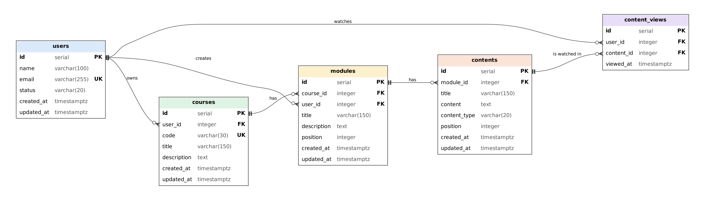

# Online Course Management API

API REST em Node.js, TypeScript, Express e Supabase para gerenciar cursos on-line, com seus módulos, conteúdos (aulas) e usuários, além de relatórios em SQL e um front-end em React.

---

## 1. Descrição do projeto

**Problema que resolve:** plataformas de cursos on-line precisam organizar o conteúdo em cursos, módulos e aulas, saber qual usuário cadastrou cada registro e acompanhar quais usuários já assistiram cada aula. Esta API centraliza esse cadastro e gera os relatórios pedidos.

**Contexto:** desafio técnico no formato de um teste prático de processo seletivo (*XPTO Tecnologia - Teste Prático Gerenciamento de Cursos com NodeJS + ReactJS*), desenvolvido na disciplina de Desenvolvimento Back-End do curso de Engenharia de Software (4º período, Turma B).

**O que a aplicação faz:**

- CRUD completo de **usuários**, **cursos**, **módulos** e **conteúdos**.
- Registro de **aulas assistidas** (qual usuário assistiu qual conteúdo).
- **5 relatórios em SQL** (usuários com mais cursos, curso com mais conteúdos, totais por curso, conteúdos com o nome do curso e usuários que assistiram a aula ID = 2).
- **Migrations** e **seeders** para criar e popular o banco.
- Documentação interativa com **Swagger** e testes automatizados com **Postman**.
- **Front-end em React** com telas de CRUD e de relatórios.

Conforme exigido no desafio, todo o código, comentários, tabelas e banco estão em **inglês**.

## 2. Integrantes da equipe

| Integrante | Responsabilidade |
|---|---|
| Erick Yuri Maba Silva | Rotas de relatórios e front-end em React |
| João Henrique Ramos | Estrutura inicial, repositório, revisão e integração |
| Leandro Augusto Alencar dos Santos | CRUD de módulos e conteúdos, aulas assistidas e collection do Postman |
| Livia Moreira Parra | CRUD de usuários e cursos e documentação Swagger |
| Lucas Indalencio Gonçalves de Lima | DER, migrations, seeders e SQLs dos relatórios |

## 3. Tecnologias utilizadas

- **Node.js** (v22 ou superior)
- **TypeScript**
- **Express** 5
- **Supabase** (PostgreSQL) com `@supabase/supabase-js`
- **node-pg-migrate** (migrations) e **pg** (seeders)
- **swagger-ui-express** (documentação OpenAPI em `/docs`)
- **React** 18 + **Vite** (front-end)
- **tsx** (execução do TypeScript em desenvolvimento)
- **Git** e **GitHub** (versionamento)
- **Postman** (testes da API; as collections estão em `docs/postman/`)

## 4. Entidades e relacionamentos

### DER



> O diagrama é gerado a partir de `docs/der.dot` (Graphviz).

### users

| Atributo | Tipo | Descrição |
|---|---|---|
| id | serial (PK) | Identificador |
| name | varchar(100) | Nome (obrigatório) |
| email | varchar(255) | E-mail (obrigatório e único) |
| status | varchar(20) | `active` ou `inactive` (padrão: `active`) |
| created_at / updated_at | timestamptz | Datas de criação e atualização (automáticas) |

### courses

| Atributo | Tipo | Descrição |
|---|---|---|
| id | serial (PK) | Identificador |
| user_id | integer (FK → users) | Usuário que cadastrou o curso |
| code | varchar(30) | Código único do curso (ex.: `NODE-101`) |
| title | varchar(150) | Título (obrigatório) |
| description | text | Descrição |
| created_at / updated_at | timestamptz | Datas de criação e atualização (automáticas) |

### modules

| Atributo | Tipo | Descrição |
|---|---|---|
| id | serial (PK) | Identificador |
| course_id | integer (FK → courses) | Curso ao qual o módulo pertence |
| user_id | integer (FK → users) | Usuário que cadastrou o módulo |
| title | varchar(150) | Título (obrigatório) |
| description | text | Descrição |
| position | integer | Ordem do módulo dentro do curso |
| created_at / updated_at | timestamptz | Datas de criação e atualização (automáticas) |

### contents

| Atributo | Tipo | Descrição |
|---|---|---|
| id | serial (PK) | Identificador |
| module_id | integer (FK → modules) | Módulo ao qual o conteúdo pertence |
| title | varchar(150) | Título (obrigatório) |
| content | text | O conteúdo da aula: URL do vídeo, texto do artigo ou descrição do quiz (obrigatório) |
| content_type | varchar(20) | `video`, `article` ou `quiz` (padrão: `video`) |
| position | integer | Ordem do conteúdo dentro do módulo |
| created_at / updated_at | timestamptz | Datas de criação e atualização (automáticas) |

### content_views (aulas assistidas)

| Atributo | Tipo | Descrição |
|---|---|---|
| id | serial (PK) | Identificador |
| user_id | integer (FK → users) | Usuário que assistiu |
| content_id | integer (FK → contents) | Conteúdo assistido |
| viewed_at | timestamptz | Quando foi assistido (automático) |

### Relacionamentos

- Um **usuário** cadastra vários **cursos** e vários **módulos** (1:N, pelo `user_id`).
- Um **curso** possui um ou mais **módulos** (1:N).
- Um **módulo** possui um ou mais **conteúdos** (1:N).
- **Usuários** e **conteúdos** têm uma relação N:N pela tabela **content_views**: um usuário assiste vários conteúdos e um conteúdo é assistido por vários usuários. O par (`user_id`, `content_id`) é único, então o mesmo usuário não registra a mesma aula duas vezes.

**Por que uma tabela nova para "aulas assistidas"?** O desafio pede para saber quais usuários assistiram uma aula. Como é uma relação N:N, colunas extras em `users` ou em `contents` não resolveriam. Por isso foi criada a tabela `content_views`, que também guarda a data em que a aula foi assistida.

> **Atenção:** as chaves estrangeiras usam `ON DELETE CASCADE`. Ao remover um **usuário**, os cursos, módulos e registros de aulas assistidas dele também são removidos. Ao remover um **curso**, os módulos e conteúdos dele também são removidos, e assim por diante.

## 5. Estrutura do projeto

```
online_course_management/
├── database/
│   ├── migrations/                 # criação das tabelas e views (node-pg-migrate)
│   ├── seeders/                    # dados de exemplo
│   ├── 01_users_with_most_courses.sql
│   ├── 02_course_with_most_contents.sql
│   ├── 03_courses_with_total_modules_and_contents.sql
│   ├── 04_contents_with_course_name.sql
│   └── 05_users_who_watched_content_2.sql
├── docs/
│   ├── der.png / der.dot           # DER
│   └── postman/                    # collections do Postman
├── frontend/                       # front-end em React + Vite
├── src/
│   ├── config/
│   │   └── supabase.ts             # conexão com o Supabase
│   ├── controller/                 # validações e respostas HTTP
│   ├── docs/
│   │   └── swagger.ts              # especificação OpenAPI
│   ├── models/                     # tipos das entidades
│   ├── repository/                 # acesso ao banco (Supabase)
│   ├── routes/                     # definição das rotas
│   ├── app.ts                      # configuração do Express, Swagger e rotas
│   └── server.ts                   # inicialização do servidor
├── .env.example                    # modelo das variáveis de ambiente
├── SETUP.md                        # guia de setup da equipe
├── package.json
└── tsconfig.json
```

**Responsabilidade de cada camada:**

- **Routes:** ligam o método HTTP + URL à função do controller.
- **Controller:** valida os dados recebidos e decide o código de resposta HTTP.
- **Repository:** única camada que conversa com o Supabase.
- **Models:** definem o formato de cada entidade.

**Fluxo de uma requisição:** Cliente → Route → Controller → Repository → Supabase → resposta em JSON.

## 6. Configuração e execução

**Pré-requisito:** Node.js 22 ou superior (`node -v` para conferir).

```bash
# 1. Clonar o repositório
git clone https://github.com/joaoramos14/online_course_management.git
cd online_course_management

# 2. Instalar as dependências
npm ci

# 3. Criar o arquivo de variáveis de ambiente
cp .env.example .env        # no Windows (cmd): copy .env.example .env
# abra o .env e preencha com as credenciais do seu projeto Supabase

# 4. Criar as tabelas e inserir os dados de exemplo
npm run db:migrate
npm run db:seed

# 5. Iniciar a API em modo desenvolvimento
npm run dev
```

A API sobe em `http://localhost:3000` e responde com um JSON de boas-vindas. A documentação Swagger fica em `http://localhost:3000/docs`.

**Scripts disponíveis:**

| Comando | O que faz |
|---|---|
| `npm run dev` | Executa em modo desenvolvimento, reiniciando ao salvar arquivos |
| `npm run build` | Compila o TypeScript para a pasta `dist/` |
| `npm start` | Executa a versão compilada (`dist/server.js`); rode `npm run build` antes |
| `npm run db:migrate` | Cria/atualiza as tabelas e views no banco |
| `npm run db:rollback` | Desfaz a última migration |
| `npm run db:seed` | **Apaga os dados** e insere os dados de exemplo |
| `npm run db:check` | Confere os tipos dos arquivos de `database/` |

## 7. Variáveis de ambiente

| Variável | Descrição | Exemplo |
|---|---|---|
| SUPABASE_URL | URL do projeto no Supabase | `https://seu-projeto.supabase.co` |
| SUPABASE_SECRET_KEY | Chave secreta do Supabase | `sb_secret_...` |
| PORT | Porta do servidor (padrão: 3000) | `3000` |
| DATABASE_URL | Conexão direta com o Postgres, usada **apenas** pelas migrations e seeders (Supabase → **Connect** → *Session pooler*) | `postgresql://postgres.<ref>:<senha>@aws-0-<regiao>.pooler.supabase.com:5432/postgres` |

O repositório inclui o `.env.example`, apenas com os nomes das variáveis. O `.env`, com as credenciais reais, **não é versionado** (está no `.gitignore`).

## 8. Banco de dados

Banco PostgreSQL hospedado no Supabase, criado por **migrations** com a biblioteca [node-pg-migrate](https://salsita.github.io/node-pg-migrate/) (`database/migrations/`):

| Migration | O que cria |
|---|---|
| `create-updated-at-function` | Função que atualiza o `updated_at` automaticamente (usada por triggers) |
| `create-users` | Tabela `users` |
| `create-courses` | Tabela `courses` |
| `create-modules` | Tabela `modules` |
| `create-contents` | Tabela `contents` |
| `create-content-views` | Tabela `content_views` (aulas assistidas) |
| `create-report-views` | Uma view para cada relatório (lidas pela API) |

O RLS (Row Level Security) está habilitado em todas as tabelas. A API acessa o banco com a chave secreta, usada apenas no servidor.

### Seeders

O comando `npm run db:seed` insere os dados de exemplo pedidos no desafio:

| Tabela | Registros |
|---|---|
| users | 5 usuários (1 deles `inactive`) |
| courses | 5 cursos |
| modules | 13 módulos |
| contents | 45 conteúdos |
| content_views | 13 aulas assistidas |

| Curso | Módulos | Conteúdos |
|---|---|---|
| NODE-101 - Node.js and TypeScript from Scratch | 5 | 3 por módulo (15) |
| SQL-201 - Relational Databases with PostgreSQL | 3 | 5 por módulo (15) |
| GIT-101 - Git and GitHub for Teams | 2 | 4 por módulo (8) |
| API-101 - Introduction to REST APIs | 1 | 3 |
| LOGIC-101 - Programming Logic | 2 | 2 por módulo (4) |

## 9. Relatórios (SQL)

As queries ficam em `database/` e podem ser executadas no **SQL Editor** do Supabase. Como o `supabase-js` não executa SQL livre, a migration `create-report-views` cria uma **view** com o mesmo SQL de cada relatório, e a API lê essas views.

| SQL | Pergunta | Arquivo | Rota da API |
|---|---|---|---|
| 01 | Quais usuários possuem mais cursos? | `01_users_with_most_courses.sql` | `GET /reports/users-most-courses` |
| 02 | Qual curso possui mais conteúdos? | `02_course_with_most_contents.sql` | `GET /reports/course-most-contents` |
| 03 | Todos os cursos, com o total de módulos e conteúdos (1 query) | `03_courses_with_total_modules_and_contents.sql` | `GET /reports/courses-totals` |
| 04 | Todos os conteúdos, com o nome do curso (1 query) | `04_contents_with_course_name.sql` | `GET /reports/contents-with-course` |
| 05 | Quais usuários já assistiram a aula (conteúdo ID = 2)? | `05_users_who_watched_content_2.sql` | `GET /reports/content-2-viewers` |

Também existe `GET /reports/content-viewers/:contentId`, que faz o SQL 05 para qualquer conteúdo.

<details>
<summary><b>SQL 01 - Usuários com mais cursos</b></summary>

```sql
SELECT
    u.id,
    u.name,
    u.email,
    COUNT(c.id)::int AS total_courses
FROM users u
LEFT JOIN courses c ON c.user_id = u.id
GROUP BY u.id, u.name, u.email
ORDER BY total_courses DESC, u.name;
```
</details>

<details>
<summary><b>SQL 02 - Curso com mais conteúdos</b> (retorna todos em caso de empate)</summary>

```sql
WITH course_contents AS (
    SELECT
        c.id,
        c.code,
        c.title,
        COUNT(ct.id)::int AS total_contents
    FROM courses c
    LEFT JOIN modules m ON m.course_id = c.id
    LEFT JOIN contents ct ON ct.module_id = m.id
    GROUP BY c.id, c.code, c.title
)
SELECT id, code, title, total_contents
FROM course_contents
WHERE total_contents = (SELECT MAX(total_contents) FROM course_contents)
ORDER BY id;
```
</details>

<details>
<summary><b>SQL 03 - Cursos com total de módulos e conteúdos</b></summary>

```sql
SELECT
    c.id,
    c.code,
    c.title,
    COUNT(DISTINCT m.id)::int AS total_modules,
    COUNT(ct.id)::int AS total_contents
FROM courses c
LEFT JOIN modules m ON m.course_id = c.id
LEFT JOIN contents ct ON ct.module_id = m.id
GROUP BY c.id, c.code, c.title
ORDER BY c.id;
```
</details>

<details>
<summary><b>SQL 04 - Conteúdos com o nome do curso</b></summary>

```sql
SELECT
    ct.id AS content_id,
    ct.title AS content_title,
    ct.content_type,
    m.title AS module_title,
    c.code AS course_code,
    c.title AS course_title
FROM contents ct
JOIN modules m ON m.id = ct.module_id
JOIN courses c ON c.id = m.course_id
ORDER BY c.id, m.position, ct.position;
```
</details>

<details>
<summary><b>SQL 05 - Usuários que assistiram o conteúdo ID = 2</b></summary>

```sql
SELECT
    u.id AS user_id,
    u.name,
    u.email,
    ct.id AS content_id,
    ct.title AS content_title,
    cv.viewed_at
FROM content_views cv
JOIN users u ON u.id = cv.user_id
JOIN contents ct ON ct.id = cv.content_id
WHERE cv.content_id = 2
ORDER BY cv.viewed_at, u.name;
```
</details>

## 10. Documentação dos endpoints

A documentação interativa completa (com "Try it out") está no **Swagger**: `http://localhost:3000/docs`.

### Rota de verificação

| Método | Endpoint | Descrição |
|---|---|---|
| GET | / | Retorna uma mensagem de boas-vindas e a versão da API |

### Usuários

| Método | Endpoint | Descrição | Dados necessários |
|---|---|---|---|
| GET | /users | Lista todos os usuários (ordenados por nome) | – |
| GET | /users/:id | Consulta um usuário pelo ID | – |
| POST | /users | Cadastra um usuário | `name` e `email` (obrigatórios); `status` (opcional) |
| PUT | /users/:id | Atualiza um usuário | `name` e `email` (obrigatórios); `status` (opcional) |
| DELETE | /users/:id | Remove um usuário (e os cursos, módulos e aulas assistidas dele) | – |

### Cursos

| Método | Endpoint | Descrição | Dados necessários |
|---|---|---|---|
| GET | /courses | Lista todos os cursos (ordenados por título) | – |
| GET | /courses/search/:keyword | Busca cursos pelo título ou descrição | – |
| GET | /courses/:id | Consulta um curso pelo ID | – |
| POST | /courses | Cadastra um curso | `user_id`, `code` e `title` (obrigatórios); `description` (opcional) |
| PUT | /courses/:id | Atualiza um curso | os mesmos campos do POST |
| DELETE | /courses/:id | Remove um curso (e os módulos e conteúdos dele) | – |

### Módulos

| Método | Endpoint | Descrição | Dados necessários |
|---|---|---|---|
| GET | /modules | Lista os módulos (`?course_id=1` filtra por curso, ordenados por `position`) | – |
| GET | /modules/:id | Consulta um módulo pelo ID | – |
| POST | /modules | Cadastra um módulo | `course_id`, `user_id` e `title` (obrigatórios); `description` e `position` (opcionais) |
| PUT | /modules/:id | Atualiza um módulo (apenas os campos enviados) | qualquer campo do POST |
| DELETE | /modules/:id | Remove um módulo (e os conteúdos dele) | – |

### Conteúdos

| Método | Endpoint | Descrição | Dados necessários |
|---|---|---|---|
| GET | /contents | Lista os conteúdos (`?module_id=1` filtra por módulo, ordenados por `position`) | – |
| GET | /contents/:id | Consulta um conteúdo pelo ID | – |
| POST | /contents | Cadastra um conteúdo | `module_id`, `title` e `content` (obrigatórios); `content_type` e `position` (opcionais) |
| PUT | /contents/:id | Atualiza um conteúdo (apenas os campos enviados) | qualquer campo do POST |
| DELETE | /contents/:id | Remove um conteúdo | – |

Se `position` não for enviado no POST, o módulo/conteúdo vai para o final do curso/módulo.

### Aulas assistidas

| Método | Endpoint | Descrição | Dados necessários |
|---|---|---|---|
| GET | /contents/:id/views | Lista os usuários que assistiram o conteúdo | – |
| POST | /contents/:id/views | Marca o conteúdo como assistido por um usuário | `user_id` (obrigatório) |
| DELETE | /contents/:id/views/:userId | Desmarca o conteúdo como assistido | – |

### Relatórios

| Método | Endpoint | Descrição |
|---|---|---|
| GET | /reports/users-most-courses | SQL 01 - Usuários com mais cursos |
| GET | /reports/course-most-contents | SQL 02 - Curso com mais conteúdos |
| GET | /reports/courses-totals | SQL 03 - Cursos com total de módulos e conteúdos |
| GET | /reports/contents-with-course | SQL 04 - Conteúdos com o nome do curso |
| GET | /reports/content-2-viewers | SQL 05 - Usuários que assistiram o conteúdo ID = 2 |
| GET | /reports/content-viewers/:contentId | SQL 05 para qualquer conteúdo |

### Validações

| Campo | Regra |
|---|---|
| `:id` (na URL) e IDs no corpo (`user_id`, `course_id`, `module_id`) | Números inteiros positivos |
| `email` | Único (não pode repetir) |
| `status` | `active` ou `inactive` |
| `code` (curso) | Único (não pode repetir) |
| `title` | Texto não vazio (até 150 caracteres em módulos e conteúdos) |
| `content_type` | `video`, `article` ou `quiz` |
| `position` | Número inteiro positivo, quando informado |
| `user_id`, `course_id`, `module_id` | Devem existir no banco |

### Códigos de resposta HTTP

| Código | Significado | Quando ocorre |
|---|---|---|
| 200 | Requisição bem-sucedida | Consultas, atualizações e remoções |
| 201 | Registro criado | `POST` bem-sucedido |
| 204 | Sem conteúdo | Remoção de módulo, conteúdo ou aula assistida |
| 400 | Dados inválidos | Campo obrigatório ausente, tipo inválido, ID inválido ou registro relacionado inexistente |
| 404 | Não encontrado | `GET`, `PUT` ou `DELETE` com um ID que não existe |
| 409 | Conflito | E-mail ou código de curso repetido, ou aula já marcada como assistida |
| 500 | Erro interno do servidor | Falha inesperada (por exemplo, erro de conexão com o banco) |

Todas as mensagens de erro são devolvidas em JSON, por exemplo:

```json
{ "message": "Course not found." }
```

## 11. Exemplos de requisições

### Criar usuário: `POST /users`

```json
{
  "name": "Maria Silva",
  "email": "maria.silva@example.com",
  "status": "active"
}
```

Resposta (`201 Created`):

```json
{
  "id": 6,
  "name": "Maria Silva",
  "email": "maria.silva@example.com",
  "status": "active",
  "created_at": "2026-10-30T22:00:00.000Z",
  "updated_at": "2026-10-30T22:00:00.000Z"
}
```

### Criar curso: `POST /courses`

```json
{
  "user_id": 1,
  "code": "DOCKER-101",
  "title": "Docker for Developers",
  "description": "Containers, images and docker compose."
}
```

### Criar módulo: `POST /modules`

```json
{
  "course_id": 6,
  "user_id": 1,
  "title": "Getting Started",
  "description": "Installing Docker and running the first container."
}
```

### Criar conteúdo: `POST /contents`

```json
{
  "module_id": 14,
  "title": "What is a container",
  "content": "https://videos.example.com/docker-101/what-is-a-container",
  "content_type": "video"
}
```

### Marcar aula como assistida: `POST /contents/2/views`

```json
{
  "user_id": 3
}
```

### Relatório: `GET /reports/courses-totals`

```json
[
  { "id": 1, "code": "NODE-101", "title": "Node.js and TypeScript from Scratch", "total_modules": 5, "total_contents": 15 },
  { "id": 2, "code": "SQL-201", "title": "Relational Databases with PostgreSQL", "total_modules": 3, "total_contents": 15 },
  { "id": 3, "code": "GIT-101", "title": "Git and GitHub for Teams", "total_modules": 2, "total_contents": 8 }
]
```

### Exemplos de erro

`POST /courses` com um código que já existe (`409 Conflict`):

```json
{ "message": "A course with this code already exists." }
```

`GET /users/abc` (`400 Bad Request`):

```json
{ "message": "Invalid user ID." }
```

## 12. Testes com o Postman

As collections ficam em `docs/postman/` e possuem **testes automáticos** em todas as requisições:

| Arquivo | O que testa |
|---|---|
| `users-courses-reports.postman_collection.json` | Usuários, cursos e os 6 relatórios (30 requisições) |
| `modules-contents.postman_collection.json` | Módulos, conteúdos e aulas assistidas (27 requisições) |

**Como usar:**

1. Inicie a API com `npm run dev`.
2. No Postman, use **Import** e selecione as duas collections.
3. Abra uma collection e clique em **Run** para executar todas as requisições em ordem.

Cada collection cria os próprios registros de teste, guarda os IDs em variáveis, testa todas as rotas (inclusive os casos de erro) e apaga tudo no final. A URL base fica na variável `baseUrl` (por padrão, `http://localhost:3000`).

## 13. Front-end (React)

O front-end fica na pasta `frontend/` e consome a API. Ele tem uma aba para cada entidade (**Users**, **Courses**, **Modules**, **Contents**), com listagem, cadastro, edição e remoção, e uma aba **Reports** com os 5 relatórios.

```bash
cd frontend
npm install
cp .env.example .env   # VITE_API_URL=http://localhost:3000
npm run dev            # http://localhost:5173
```

A API precisa estar rodando (`npm run dev` na raiz do projeto).

## 14. Itens opcionais não realizados

O desafio lista alguns itens opcionais que a equipe optou por não implementar nesta entrega:

- **Docker**
- **Deploy** (Heroku ou similar)
